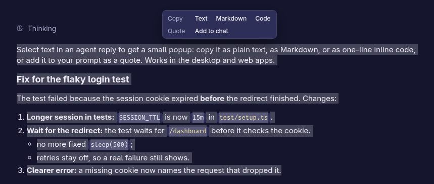

# Paseo popup copy

A [Paseo](https://paseo.sh) plugin. Select text in an agent reply and a small popup shows up:



- **Text**: copies the text as you see it.
- **Markdown**: copies it with formatting (lists, bold, code). Same as Ctrl+C on a reply.
- **Code**: puts it on one line and wraps it in backticks, like `` `npm run build` ``.
- **Add to chat**: adds it to the end of your prompt as a `>` quote, with an empty line after it.

Add to chat uses the focused agent tab. If no agent tab is focused, it copies the quote instead.

Works in the desktop and web apps. On iOS and Android the system selection menu is used, so there's no popup. Needs Paseo 0.16 or newer.

## Install

```bash
paseo plugin install github:wlecki/paseo-popup-copy
```

## Credits

The popup is based on the one in [paseo-chat-polish](https://github.com/lthieu96/paseo-chat-polish) by Hieu Le (MIT).

## License

MIT
